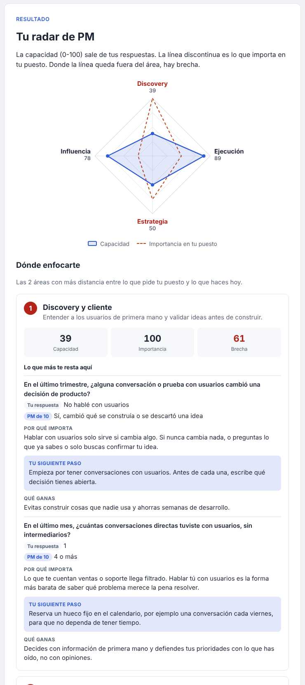
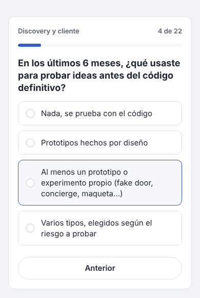

# Skill Matrix PM · PM Radar

**[English](#english) · [Español](#español)**

  

---

## English

**PM Radar** is a WordPress plugin with a fact-based self-assessment for Product Managers. It asks what you have actually done in recent months, not how good you think you are. In 10-12 minutes it shows you a skills radar and the 2 areas where improving will matter most for your role.

### Why it exists

Most PM self-assessments ask you to rate yourself ("How good are you at discovery? 1-5"). That measures self-perception: we tend to see ourselves better, or worse, than we are. PM Radar replaces those ratings with countable, recent facts, such as:

> *In the last month, how many direct conversations did you have with users, without intermediaries?*
> None · 1 · 2-3 · 4 or more

### What it does

- **22 closed questions** across 4 areas: Discovery & customer, Execution & delivery, Strategy & business, Influence & stakeholders.
- **Importance for your role:** before answering, you rate how much each area matters in your current job.
- **Gap analysis:** the 2 focus areas are the ones with the largest gap between what your role needs and what you do today.
- **Actionable result:** for the questions that pull you down most, it explains why they matter, gives you a next step based on your answer and tells you what you gain.
- **No AI, no sign-up, no server:** everything is calculated in the browser. Answers never leave the user's device.
- **Mobile-friendly**, one question per screen, with progress saved if the page is reloaded.

> The questionnaire text is currently in **Spanish**.

### Installation

1. Download [`dist/pm-radar.zip`](dist/pm-radar.zip) (click the file, then *Download raw file*).
2. In WordPress: **Plugins → Add New → Upload Plugin**, choose the zip, install and activate.
3. Add a *Shortcode* block to any post or page:

| Shortcode | Use |
| --- | --- |
| `[pm-radar]` | Public version. |
| `[pm-radar discovery="si"]` | Testing version: also asks how people see themselves in each area and adds buttons to copy or download results (CSV), so testers can send them to you. The perception-vs-facts comparison only appears in the export, not on screen. |

### How scoring works

| Concept | Rule |
| --- | --- |
| Capability (0-100) | Points ÷ (3 × answered questions) × 100. Each option is worth 0, 1, 2 or 3 points. "Not applicable" doesn't count. |
| Importance (0-100) | Rating 1-5 converted: 1 = 0, 2 = 25, 3 = 50, 4 = 75, 5 = 100. |
| Gap | Importance − capability. Shown without sign: red if there is a gap, green if not. |
| Focus areas | The 2 areas with the largest positive gap. Ties: lower capability first. If no area has a gap, the 2 with the lowest capability. |
| Seniority ceiling | The top answer reflects a solid PM, not organisation-wide leadership, so junior and mid PMs aren't penalised. |

### Customising

All questions, options, areas and recommendations live in [`pm-radar/data/preguntas.json`](pm-radar/data/preguntas.json). Each question has:

- `opciones`: 4 answers, worth 0 to 3 points in order.
- `na`: whether "Not applicable" is allowed.
- `porQue`: why it matters.
- `siguientePaso`: 3 next steps; the one shown depends on whether the user picked option 0, 1 or 2.
- `beneficio`: what the PM gains.

If you change the questions, bump `version` in that file so half-finished answers from the previous version are discarded. Colours can be changed with the CSS variables at the top of `pm-radar/assets/pm-radar.css`.

### Sources

- Marty Cagan, [Coaching Tools – The Assessment](https://www.svpg.com/coaching-tools-the-assessment/) (SVPG, 2019): gap analysis between importance and capability.
- Marty Cagan, [Product Risk Taxonomies](https://svpg.com/product-risk-taxonomies) (SVPG): the 4 product risks.
- Ravi Mehta's competency model, as summarised in [12 Essential Product Manager Skills](https://www.reforge.com/blog/product-manager-skills) (Reforge): 12 competencies in 4 areas.
- Teresa Torres, [Opportunity Solution Trees](https://www.producttalk.org/opportunity-solution-trees/) (Product Talk).

### License

GPL-2.0-or-later, like WordPress.

---

## Español

**PM Radar** es un plugin de WordPress con una autoevaluación para Product Managers basada en hechos. Pregunta qué has hecho de verdad en los últimos meses, no lo bueno que crees que eres. En 10-12 minutos te muestra un radar de competencias y las 2 áreas donde más te conviene mejorar para tu puesto.

  

### Por qué existe

Casi todas las autoevaluaciones para PMs te piden que te puntúes ("¿Cómo de bueno eres en discovery? 1-5"). Eso mide la autopercepción: solemos vernos mejor, o peor, de lo que somos. PM Radar sustituye esas notas por hechos recientes y contables, por ejemplo:

> *En el último mes, ¿cuántas conversaciones directas tuviste con usuarios, sin intermediarios?*
> Ninguna · 1 · 2-3 · 4 o más

### Qué hace

- **22 preguntas cerradas** en 4 áreas: Discovery y cliente, Ejecución y entrega, Estrategia y negocio, Influencia y stakeholders.
- **Importancia en tu puesto:** antes de responder, indicas cuánto importa cada área en tu trabajo actual.
- **Análisis de brecha:** las 2 áreas a mejorar son las de mayor distancia entre lo que pide tu puesto y lo que haces hoy.
- **Resultado accionable:** en las preguntas que más te restan, explica por qué importan, te da un siguiente paso según lo que respondiste y te dice qué ganas.
- **Sin IA, sin registro y sin servidor:** todo se calcula en el navegador. Las respuestas no salen del dispositivo de quien responde.
- **Adaptado a móvil**, una pregunta por pantalla, y guarda el progreso si se recarga la página.

### Instalación

1. Descarga [`dist/pm-radar.zip`](dist/pm-radar.zip) (abre el archivo y pulsa *Download raw file*).
2. En WordPress: **Plugins → Añadir nuevo → Subir plugin**, elige el zip, instálalo y actívalo.
3. Añade un bloque *Shortcode* en cualquier entrada o página:

| Shortcode | Uso |
| --- | --- |
| `[pm-radar]` | Versión pública. |
| `[pm-radar discovery="si"]` | Versión de pruebas: pregunta también cómo se ve cada persona en cada área y añade botones para copiar o descargar los resultados (CSV), para que quien lo pruebe te los envíe. La comparación entre percepción y hechos solo va en lo exportado, no se muestra en pantalla. |

### Cómo se puntúa

| Concepto | Regla |
| --- | --- |
| Capacidad (0-100) | Puntos ÷ (3 × preguntas respondidas) × 100. Cada opción vale 0, 1, 2 o 3 puntos. "No aplica" no cuenta. |
| Importancia (0-100) | Nota de 1 a 5 convertida: 1 = 0, 2 = 25, 3 = 50, 4 = 75, 5 = 100. |
| Brecha | Importancia − capacidad. Se muestra sin signo: en rojo si hay brecha y en verde si no. |
| Áreas a mejorar | Las 2 con mayor brecha positiva. En caso de empate, primero la de menos capacidad. Si ninguna tiene brecha, las 2 con menos capacidad. |
| Techo de seniority | La respuesta máxima refleja a un PM sólido, no un liderazgo a nivel de toda la organización, para no penalizar a PMs junior y mid. |

### Personalizar

Las preguntas, opciones, áreas y recomendaciones están en [`pm-radar/data/preguntas.json`](pm-radar/data/preguntas.json). Cada pregunta tiene:

- `opciones`: 4 respuestas, que valen de 0 a 3 puntos en orden.
- `na`: si admite "No aplica".
- `porQue`: por qué importa.
- `siguientePaso`: 3 siguientes pasos; se muestra uno u otro según si se eligió la opción 0, 1 o 2.
- `beneficio`: qué gana el PM.

Si cambias las preguntas, sube `version` en ese archivo para descartar las respuestas a medias de la versión anterior. Los colores se cambian con las variables CSS al principio de `pm-radar/assets/pm-radar.css`.

### Fuentes

- Marty Cagan, [Coaching Tools – The Assessment](https://www.svpg.com/coaching-tools-the-assessment/) (SVPG, 2019): análisis de brecha entre importancia y capacidad.
- Marty Cagan, [Product Risk Taxonomies](https://svpg.com/product-risk-taxonomies) (SVPG): los 4 riesgos de producto.
- El modelo de competencias de Ravi Mehta, resumido en [12 Essential Product Manager Skills](https://www.reforge.com/blog/product-manager-skills) (Reforge): 12 competencias en 4 áreas.
- Teresa Torres, [Opportunity Solution Trees](https://www.producttalk.org/opportunity-solution-trees/) (Product Talk).

### Licencia

GPL-2.0-or-later, como WordPress.
